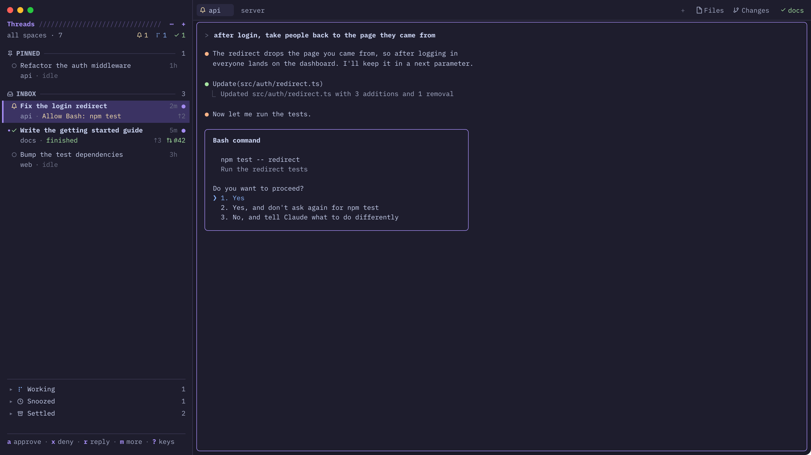
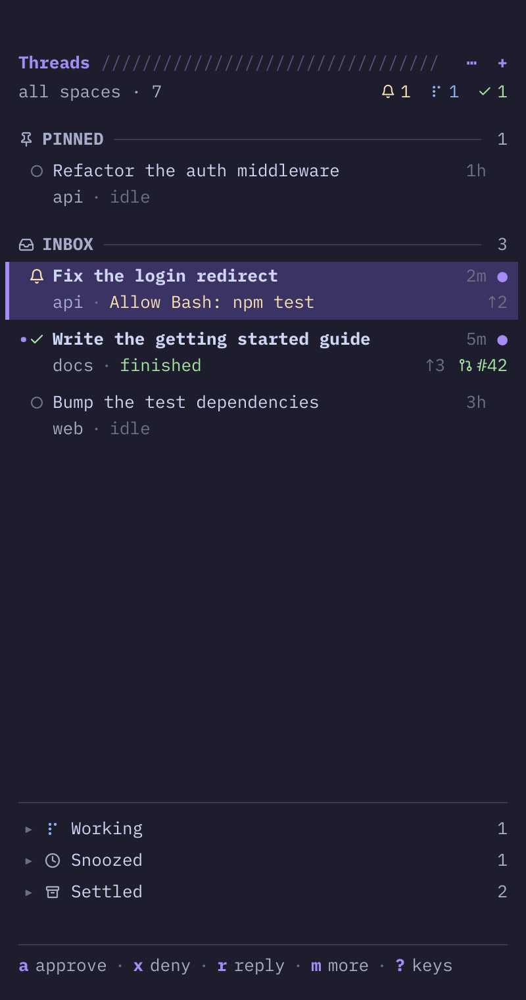
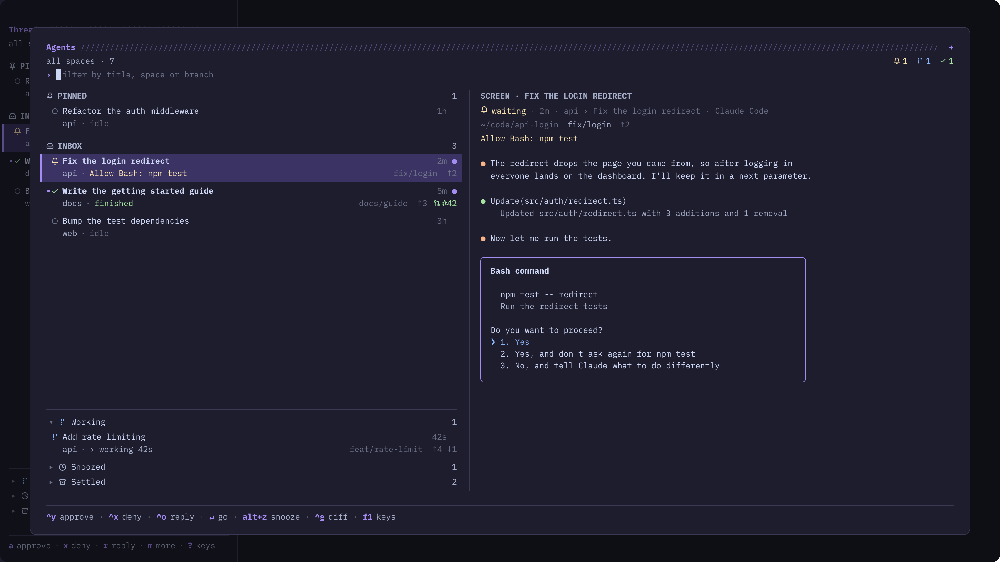
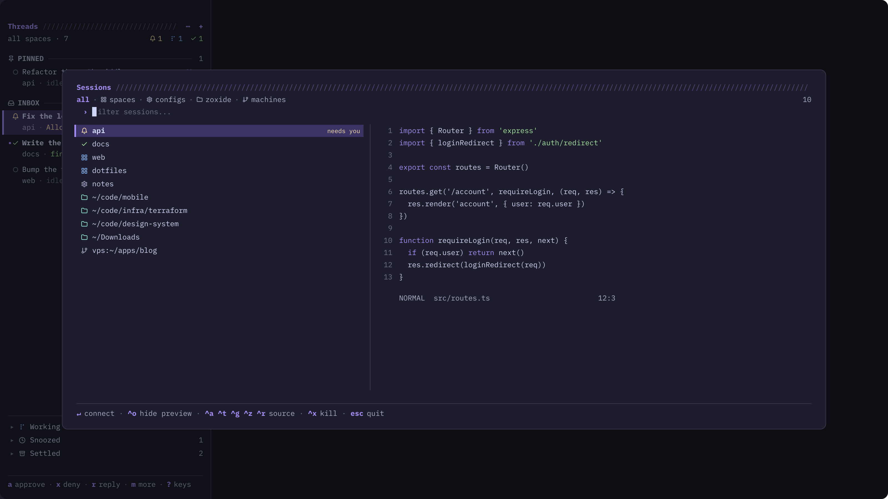
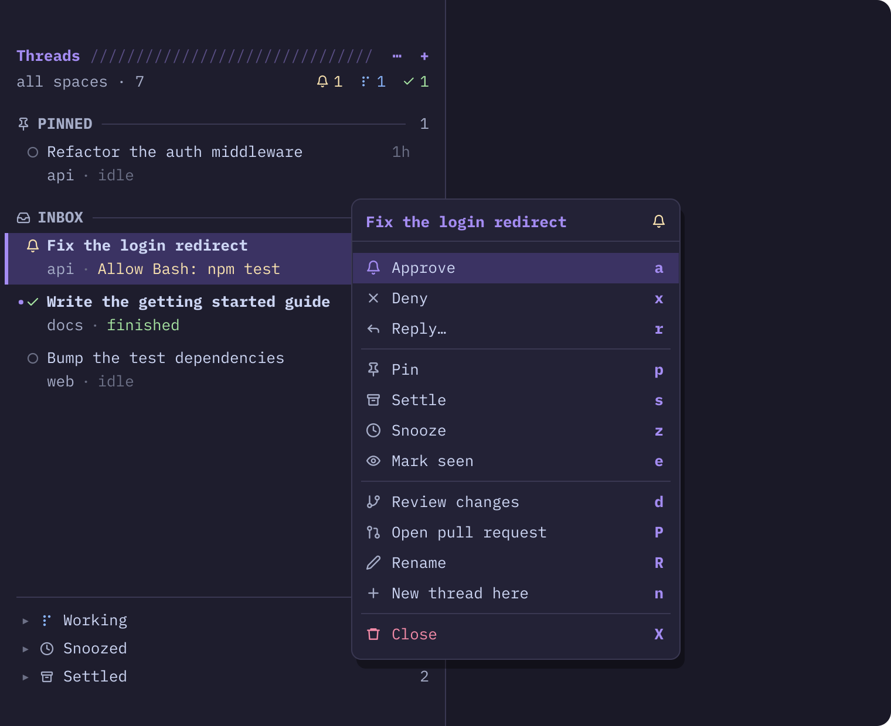

# herdr-sesh

**A keyboard-first layout for the [Herdr](https://herdr.dev) desktop app: a thread sidebar that triages your coding agents, an agent picker with a live screen, and a sesh-style session picker, all on the keyboard.**



If you run several Claude Code, Codex or other agents at once, a list sorted by status isn't enough. herdr-sesh sorts them like an inbox:

- **Pinned** for the threads you keep in view,
- **Inbox** for everything else, newest activity first,
- and **Working**, **Snoozed** and **Settled** shelves for the ones that don't need you right now.

You can see what each agent is asking for ("Allow Bash: npm test"). You can approve it, deny it or reply without leaving the window you're in.

The images in this README are mockups with made-up data, drawn in the layout's real colors and fonts (`scripts/gen-images.py`).

## Contents

- [Install](#install)
- [What you get](#what-you-get)
  - [The thread sidebar](#the-thread-sidebar)
  - [The agent picker](#the-agent-picker-cmd-a)
  - [The session picker](#the-session-picker-cmd-p)
  - [The actions menu](#the-actions-menu)
  - [The attention strip and notifications](#the-attention-strip-and-notifications)
- [Keys](#keys)
- [Configuration](#configuration)
- [Update and uninstall](#update-and-uninstall)
- [What it runs and reads](#what-it-runs-and-reads)
- [How it's built](#how-its-built)
- [How it handles agents](#how-it-handles-agents)
- [Troubleshooting](#troubleshooting)

## Install

You need [Herdr](https://herdr.dev) **0.1.15 or newer**, opened at least once, and `python3` (on macOS it comes with `xcode-select --install`).

Install with one line:

```sh
curl -fsSL https://raw.githubusercontent.com/xheisenbugx/herdr-sesh/main/install.sh | sh
```

Or from a clone:

```sh
git clone https://github.com/xheisenbugx/herdr-sesh
cd herdr-sesh
sh install.sh
```

The installer:

1. copies the layout, its theme and its seven mods into `~/.config/herdr-app` (or `$HERDR_APP_HOME`);
2. merges the layout's keys into your `keys.json`, and keeps a backup (`keys.json.bak-<time>`). It only touches the sections it ships (`layout:herdr-sesh`, `mod:sesh-agents`, `mod:sesh-sessions`, `mod:sesh-menu`). Your other keys stay as they are;
3. checks every mod with `herdr-app check`;
4. switches Herdr to the layout.

It never overwrites anything of yours. If a file with the same name is already there, it stops and tells you. `--force` replaces them anyway, keeping each of yours as `<name>.bak-<time>`. `--no-switch` installs without switching.

> [!NOTE]
> Herdr treats an edited `keys.json` as yours, and stops adding its new default shortcuts to it when it updates. Once the installer has merged its keys, new Herdr shortcuts have to be added by hand (`herdr-app commands` and Herdr's release notes list them).

Your own layout is not touched. **`cmd-shift-l`** cycles through your layouts, and **Settings → Look** lists them all.

### Optional tools

| tool | used for |
| --- | --- |
| `git` | branches, commits ahead `↑` / behind `↓`, diffs and reviews |
| [`gh`](https://cli.github.com) | the pull request number on each thread, and opening it in the browser |
| [`zoxide`](https://github.com/ajeetdsouza/zoxide) | the directories you use, in the session picker |
| [Claude Code](https://claude.com/claude-code) | resuming a closed thread with `claude --resume` |

## What you get

### The thread sidebar

<p align="center"></p>

The sidebar lists every agent as a **thread**. Each thread has two lines:

- **the first line:** its status, title, how long ago it last changed, and a `•` when it finished while you weren't looking;
- **the second line:** its space and what it needs or is doing, then its branch, commits ahead and behind, and its pull request.

| status | looks like | means |
| --- | --- | --- |
| waiting | yellow bell | it needs you: a permission prompt or a question |
| done | green check | it finished while you weren't looking (unread) |
| working | blue dots, pulsing | it's busy and doesn't need you |
| idle | grey circle | nothing going on |

Threads move between sections on their own:

| section | holds |
| --- | --- |
| **Pinned** | threads you pinned, in your order (`p`, then `K` / `J` to reorder) |
| **Inbox** | everything else, newest activity first |
| **Working** | agents busy on something that doesn't need you |
| **Snoozed** | hidden until a time you pick (1 hour, 3 hours, this evening, tomorrow, next week, or any time), or until the agent needs you |
| **Settled** | done with: settled by hand, after a week idle, or once its pull request is merged |

A snoozed agent that starts waiting on you wakes up by itself. A settled one that you send a new prompt comes back to the inbox.

**Threads outlive their panes.** If you close a Claude Code agent's pane, its thread stays in Settled as a *closed* thread. Press `enter` on it to resume the conversation (`claude --resume`) in its old space and folder.

Click a thread to go to it. Hover over one for its pin, snooze and settle buttons; snooze opens the same list of times as `z` and the actions menu. To drive the sidebar from the keyboard, press **`cmd-shift-b`** to move into it and again to go back. Press **`?`** for every key.

### The agent picker (`cmd-a`)



The picker opens every agent in one big window, with the selected agent's live screen beside the list.

- Type to filter, fzf style (`lgn` finds `login`).
- Press `ctrl-g` to see the agent's diff instead of its screen.
- Snoozed and settled threads start folded away, and open as soon as you type, so any thread is always one search away.

| key | does |
| --- | --- |
| `enter` | go to the agent (or resume a closed thread) |
| `ctrl-y` | approve a waiting agent |
| `ctrl-x` | deny a waiting agent, or interrupt a working one |
| `ctrl-o` | reply |
| `ctrl-s` | mark a finished agent seen |
| `ctrl-g` | show its diff instead of its screen, and back |
| `alt-d` | the full review in a pane: commits, files and diff since its branch left the base |
| `ctrl-d` / `ctrl-u` | scroll the preview |
| `alt-p` `alt-s` `alt-z` `alt-e` | pin, settle, snooze for an hour, wake |
| `alt-b` | open its pull request |
| `alt-w` | close its pane (press it twice) |
| `alt-space` / `alt-m` | its actions menu |
| `f1` | every key |

### The session picker (`cmd-p`)



The session picker works like [sesh](https://github.com/joshmedeski/sesh), with Herdr spaces as the sessions. It lists:

- **spaces:** your Herdr spaces, the ones that need you first;
- **configs:** the `[[session]]` entries in herdr-sesh's own config, `~/.config/herdr-sesh/config.toml` (see [Configuration](#configuration));
- **zoxide:** the directories you use most;
- **machines:** zoxide directories on your other Herdr machines (`hc machine ls`).

When you pick a directory, Herdr goes to the space already open there, or opens a new space in it. A new space runs the session's `startup_command`, or `[default_session].startup_command`, the same way sesh does.

| key | does |
| --- | --- |
| `enter` | go to the session |
| `ctrl-a` `ctrl-t` `ctrl-g` `ctrl-z` `ctrl-r` | show all, spaces, configs, zoxide, machines |
| `ctrl-x` | close the space, or forget a zoxide directory |
| `ctrl-o` | show or hide the preview |
| `esc` | quit |

### The actions menu

<p align="center"></p>

The actions menu lists everything you can do to a thread, each item with its sidebar letter. Open it in any of these ways:

- right-click a thread;
- press `space` or `m` in the sidebar;
- press `alt-space` in the agent picker;
- right-click an agent's terminal and choose **Thread actions…**.

In the agent picker the menu opens over the picker, at the row. The picker stays open for actions that keep you there (pin, settle, snooze, approve, reply…), and closes for ones that take you elsewhere (go, review, rename, new thread).

### The attention strip and notifications

- **The attention strip** sits at the right end of the tab bar. It names the *other* spaces where an agent is waiting on you or has finished. Click one to go there.
- **Notifications:** while Herdr isn't the app in front, a waiting or finished agent also posts a macOS notification.
- **Worktrees:** when you open a new git worktree, the files your repo's `.worktreeinclude` lists are copied into it from the main checkout.

## Keys

`cmd` is ⌘. Every key below applies only while this layout is shown. The installer puts them in `keys.json` under `layout:herdr-sesh`.

| key | does |
| --- | --- |
| `cmd-p` | session picker |
| `cmd-shift-p` | back to the previous space |
| `cmd-a` | agent picker |
| `cmd-j` | the agent that needs you next (the one waiting longest first) |
| `cmd-shift-j` | back to the agent you were with before |
| `cmd-b` | show or hide the sidebar |
| `cmd-shift-b` | into the sidebar and back out |
| `cmd-ctrl-p` `s` `z` `w` | pin, settle, snooze for an hour, or wake the thread you're in |
| `cmd-ctrl-j` / `cmd-ctrl-k` / `cmd-ctrl-1`–`9` | next, previous, nth thread of the sidebar |
| `cmd-t` | new tab |
| `cmd-enter` / `cmd-d` / `cmd-\|` | split right |
| `cmd-shift-d` | split down |
| `cmd-h` / `cmd-l` | previous / next tab |
| `cmd-i` / `cmd-o` | previous / next pane |
| `cmd-w` | close the pane |
| `cmd-z` | zoom the pane |
| `cmd-r` / `cmd-shift-r` | rename the tab / the space |
| `cmd-alt-p` | Herdr's command palette (`cmd-shift-p` is taken by "previous space") |

> [!NOTE]
> A few of these keys replace what macOS or Herdr usually does with them, but only in this layout: `cmd-a` (select all), `cmd-h` (hide the app), `cmd-z` (undo) and `cmd-shift-p` (the palette). To change one, edit the `layout:herdr-sesh` section of `~/.config/herdr-app/keys.json`. Herdr applies the change at once, and updating the layout keeps it.

### In the sidebar

| key | does |
| --- | --- |
| `enter` / click | go to the thread (open a shelf, resume a closed thread) |
| `esc` | back to your window |
| `j` `k` `g` `G` / `tab` | move / next section |
| `1`–`9` | go to the nth thread |
| `a` `x` `r` | approve; deny or interrupt; reply |
| `p` / `K` `J` | pin or unpin / move a pin up or down |
| `s` | settle or restore |
| `z` / `w` | snooze / wake |
| `e` | mark a finished thread seen |
| `u` | undo the last pin, settle, snooze or wake |
| `d` | review its changes |
| `P` | open its pull request |
| `n` / `N` | new thread / new thread in a new worktree |
| `R` | rename the thread |
| `X` | close its pane (press it twice), or forget a closed thread |
| `A` | archive: remove its worktree |
| `space` / `m` / right click | the actions menu |
| `/` | filter |
| `o` / `f` | group the inbox by space / only this space |
| `<` `>` | narrower, wider |
| `q` | hide the sidebar |
| `?` | every key |

## Configuration

There's nothing to set up, but these files change how it behaves:

- **`~/.config/herdr-sesh/config.toml`**: herdr-sesh's own settings file. The installer creates it from [`config.example.toml`](config.example.toml) with everything commented out, and never overwrites or deletes it. The session picker reads it each time it opens, so edits apply at once.

  ```toml
  # Runs in every new space the session picker opens from a directory.
  [default_session]
  startup_command = "nvim"

  # Sessions you always want in the picker (its "configs" source, ctrl-g).
  [[session]]
  name = "dotfiles"
  path = "~/dotfiles"
  startup_command = "nvim"   # else [default_session]'s
  ```

  When you pick a session, Herdr goes to the space already open in its `path`, or opens a new space there, named `name`, running its `startup_command`.

- **`.worktreeinclude`** at a repo's root: one path or glob per line. These files are copied into each new worktree (`.env`, `config/*.local`, …). Lines starting with `#` and `!` are skipped, and nothing outside the repo is touched.
- **The look:** the layout brings its own dark purple theme (`themes/herdr-sesh.json`) and uses JetBrains Mono for the panels. Herdr's theme picker still overrides it. Your terminal font comes from your Herdr settings.

## Update and uninstall

```sh
sh install.sh                  # update: run it again (or the curl line)
sh install.sh --uninstall      # remove the layout, its theme, its mods and its keys
```

Uninstalling keeps your `~/.config/herdr-sesh/config.toml`; delete it yourself if you want it gone.

The installer records every file it installed in `~/.config/herdr-app/.herdr-sesh`. An update replaces only those files and removes the ones the layout no longer has; uninstalling removes only those, so files you added to its mod folders stay.

Your edits to the layout's keys survive updates: the installer remembers what it installed (`.herdr-sesh-keys.json`), so a key you changed, removed or added stays as you left it, a key you didn't touch follows the layout, and new ones are added. Uninstalling removes only the keys you didn't change.

To uninstall without the script, delete these and the `layout:herdr-sesh` and `mod:sesh-*` sections of `keys.json`:

- `layouts/herdr-sesh.json` and `layouts/herdr-sesh.svg`
- `themes/herdr-sesh.json`
- `mods/sesh-*`

## What it runs and reads

Herdr mods are trusted code, so here is everything this layout does outside its own folder:

- **Programs:**
  - `hc` (herdr-core), to read an agent's screen, press Enter or Esc for you, send a reply, interrupt it, and label it seen;
  - `git`, for branches, ahead/behind and diffs;
  - `gh`, for pull request numbers (this is the only network access, to GitHub, through your own `gh` login);
  - `zoxide` and `ls`, for the session picker's directories and previews;
  - `sh`, for the `.worktreeinclude` copy and a session's `startup_command`;
  - `osascript`, for macOS notifications.
- **Files it reads:**
  - `~/.config/herdr-sesh/config.toml`, its settings;
  - `~/.claude/sessions/<pid>.json`, to learn each Claude Code conversation's id so a closed thread can be resumed.
- **Its state:** pins, snoozes and settled threads live in Herdr's own shared state (`shared.json`). Nothing is sent anywhere.

## How it's built

```
layouts/herdr-sesh.json     the window: the sidebar | tab bar + attention strip / the panes
layouts/herdr-sesh.svg      the picture Settings shows for it
themes/herdr-sesh.json      the theme
keys.json                   the layout's keys (merged into yours)
mods/
  sesh-sidebar/             the thread sidebar, its icons, and lib.js (the shared thread model)
  sesh-agents/              the agent picker (a dialog)
  sesh-sessions/            the session picker (a dialog)
  sesh-menu/                the actions menu (a popup)
  sesh-bar/                 the attention strip; receives the global keys and tracks thread state
  sesh-term-menu/           the terminal right-click menu, with "Thread actions…"
  sesh-toast/               notifications, and the macOS notification when Herdr is in the back
install.sh                  install, update, uninstall
config.example.toml         the commented settings file the installer starts you with
scripts/gen-images.py       draws the README images
RECIPE.md                   the brief another agent can build this from
```

Herdr mods can't import from each other's folders, so `lib.js` is copied into every mod that needs it. Edit `mods/sesh-sidebar/lib.js`, then run `mods/sesh-sidebar/sync-lib.sh`, then `herdr-app check mods/<name>`.

To work on it, edit the copies in `~/.config/herdr-app/mods/`. Herdr reloads them live as you save. Copy them back here when you're done.

## How it handles agents

- **Sessions are spaces.** A session in the picker is a Herdr space; the windows inside it are Herdr tabs and panes.
- **No hooks to install.** herdr-core detects each agent's status by itself.
- **"What it needs"** ("Allow Bash: npm test") is read from the agent's screen. If a prompt looks unusual, the sidebar just says "needs you".
- **Approve and deny** press Enter and Esc in the agent's terminal. **Reply** presses Esc first if the agent is waiting, then types your text.

## Troubleshooting

| problem | fix |
| --- | --- |
| The layout isn't in Settings | Check that `~/.config/herdr-app/layouts/herdr-sesh.json` exists. If a `layout.error` file sits next to it, it says why. |
| A panel is blank or shows an error | Run `herdr-app status` (it lists mod errors), then `herdr-app check ~/.config/herdr-app/mods/<name>`. |
| A key does nothing | Check for a `keys.error` file in `~/.config/herdr-app`. Also check that you're on the herdr-sesh layout: its keys only apply there. |
| No branch, ahead/behind or PR | Install `git` / `gh` and run `gh auth login`. |
| You want your old window back | Press `cmd-shift-l`, or use Settings → Look. `ctrl-alt-shift-escape` always goes back to Herdr's default layout. |

## License

MIT. The session picker follows Josh Medeski's [sesh](https://github.com/joshmedeski/sesh).
