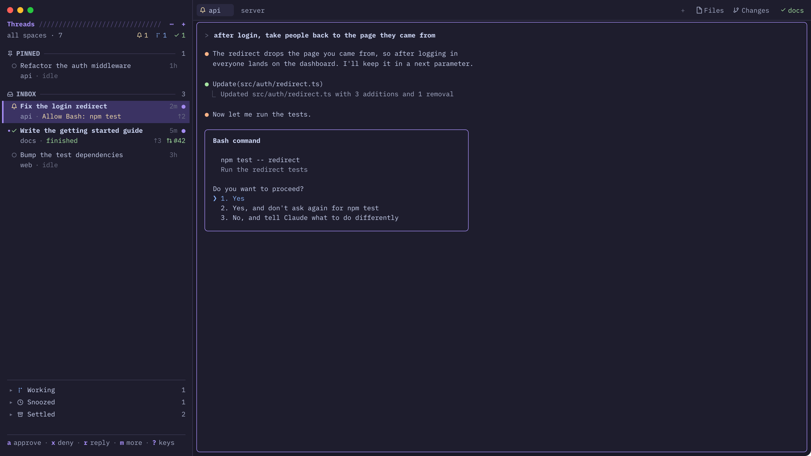

# herdr-sesh

A keyboard-first layout for coding agents. A thread sidebar on the left sorts every agent into Pinned, Inbox and three folded shelves (Working, Snoozed, Settled). Each thread shows what the agent needs ("Allow Bash: npm test"), its branch and its PR. Two full-window pickers sit on `cmd-a` (agents, with the selected agent's live screen) and `cmd-p` (sessions: spaces, `[[session]]` entries from `~/.config/herdr-sesh/config.toml`, zoxide, other machines). Everything is monospace, dark purple and terminal-like.

## What you see

Left to right:

- **The sidebar** (column `sidebar`, 340px, 220–560, background `chrome`). One block, `sesh-sidebar`, with `window_drag`. From the top:
  - 40px of room for the traffic lights;
  - the title row: **Threads** in bold accent `#a48cf2`, a run of `/` at 45% opacity filling the rest, then `⋯` and `+`;
  - "all spaces · N" in muted `#a6adc8`, with counts on the right: bell `#f9e2af` (waiting), dots `#89b4fa` (working), check `#a6e3a1` (done);
  - section heads ("PINNED ──── 1", "INBOX ──── 3"): an icon, a bold muted label, a 1px `#3a3852` rule and a count;
  - thread rows (two lines, 13px). The selected row has a `#3b3363` background and a 3px accent bar on its left edge;
  - at the bottom, behind a rule: the shelves Working, Snoozed and Settled, each with `▸` / `▾`, an icon and a count;
  - a hint footer ("a approve · x deny · r reply · ? keys") with the keys in bold accent.
- **The work column**:
  - a 38px row: Herdr's `tabs` mod, then a 300px `sesh-bar` block (the attention strip, right-aligned names of other spaces that are blocked or done, each with its bell or check);
  - the active tab's panes: gap 6, radius 6, background `background`, 1px `border`, accent when focused, padding [0, 6].

**Theme** (`themes/herdr-sesh.json`, the layout's own):

| colour | value |
| --- | --- |
| background / chrome | `#1e1d2d` |
| canvas | `#1a1927` |
| popover | `#232236` |
| selected | `#3b3363` |
| border | `#3a3852` |
| foreground | `#cdd6f4` |
| muted | `#a6adc8` |
| dim | `#6c7086` |
| accent | `#a48cf2` |
| working | `#89b4fa` |
| blocked | `#f9e2af` |
| done | `#a6e3a1` |

The ANSI colours are Catppuccin-like. `ui_font` is JetBrains Mono.

**Thread row:**

- Line 1: an unread `•`, a 12px status glyph, the title (bold when selected, unread or waiting), the age (`2m`) in dim, and a `●` when unread.
- Line 2, indented 23px:
  - the space name, `·`, then the detail, coloured by status: "Allow Bash: npm test" in blocked, "finished" in done, "› working 42s" in muted, "idle" in dim, or "snoozed until 18:00";
  - on the right: the branch (pickers only, not main/master), `↑n` `↓n`, and a PR icon with `#42`, green while open and accent when merged.

**Agent picker** (`sesh-agents`, a dialog 94% × 90%, frame none, radius 10):

- The title "Agents ////", the counts, and a `›` filter input.
- On the left, 46%: the same sections as the sidebar.
- On the right, the preview:
  - "SCREEN · TITLE" (or "DIFF · …") with a rule;
  - a status line;
  - the folder, branch and ↑;
  - what the agent needs;
  - then the agent's screen, the tail of `hc read --lines 400`. In diff mode it's `git diff HEAD`, with `+` in done, `-` in ansi1 and `@@` in accent.
- A hint footer.

**Session picker** (`sesh-sessions`, a dialog 86% × 72%):

- The title "Sessions ////".
- The source chips: all · spaces · configs · zoxide · machines. The active one is bold accent.
- A filter input.
- On the left, 40%: the list. Spaces show their status glyph (else a blue grid), configs a gear, zoxide folders a teal folder, machines a branch.
- On the right: the preview, either the space's screen or an `ls` of the folder.

**Actions menu** (`sesh-menu`, a 260 × 460 popup): the thread's title in accent, then rows with an icon, a label and the sidebar letter on the right (Approve a, Deny x, Reply… r | Pin p, Settle s, Snooze z, Mark seen e | Review d, Open PR P, Rename R, New thread n | Close X in red).

## How it behaves

**Statuses:**

| status | glyph |
| --- | --- |
| waiting (blocked) | bell `#f9e2af` |
| done (unread) | check `#a6e3a1`, with `•` / `●` |
| working | dots `#89b4fa`, looping opacity 0.35→1 over 1100ms |
| idle | circle, dim |

**Sections:**

- Pinned: Herdr's `terminal.pin`, ordered by `shared("sesh").pins`.
- Inbox: everything else, newest status change first.
- Working.
- Snoozed: until a time.
- Settled: by hand, after 7 days idle, or once its PR is merged.

**Moves between sections:**

- An agent that turns blocked leaves a snooze.
- An agent that turns working or blocked after being settled leaves Settled.
- A closed Claude Code pane leaves a *closed* thread in Settled for two weeks. Enter resumes it with `claude --resume <id>` in its space and folder.

**Sidebar keys** (it's `focusable`; `cmd-shift-b` enters and leaves):

- move: j k g G tab, 1–9;
- act: a (`hc keys enter`), x (`hc keys esc`, or `hc interrupt` while working), r (reply: Esc if blocked, then `hc send --force`);
- p / K J pin and reorder, s settle, z snooze (a menu), w wake, e mark seen (label `herdr.seen=<turn>`), u undo;
- d review (a right split with `git log` + `diff` since the merge base), P PR in the browser;
- n new claude tab, N new worktree (the `worktree` dialog), R rename the tab, X close the pane, A archive (the worktree remove dialog);
- space / m / right-click the menu, / filter, o group by space, f only this space, < > resize, q hide, ? keys.

**Agent picker keys:** ctrl-y / x / o / s / g / d / u, alt-p / s / z / e / b / w / d / space, f1, Esc. A single click selects a thread; a double click goes to it. A right click (or alt-m) opens the actions menu over the picker at the click, or under the selected row (`at: {x, y}` from the row's mouse events: `at: "pointer"` lands at a stale spot inside a dialog); the picker stays open unless the action leaves it, and the menu sends `sesh-agents.focus` when it closes so typing goes back to the filter.

**Session picker keys:** ctrl-a / t / g / s / z / r pick the source, ctrl-x closes the space or runs `zoxide remove`, ctrl-o toggles the preview. Enter goes to an existing space, or runs `space.new {folder, argv: ["sh","-c",startup_command]}`.

**Global keys** (`layout:herdr-sesh`) go to `sesh-bar.<command>`, so they work while the sidebar is hidden:

- last, agent-last;
- need-next (blocked first, then done, waiting longest first);
- pin, settle, snooze, wake;
- thread-next / prev / `thread:N`;
- pane-next / prev;
- sidebar.

`sesh-bar` also polls every second. It stamps status changes, expires snoozes, records the previous space, captures Claude Code session ids, and copies `.worktreeinclude` files into fresh worktrees.

The toast mod also runs `osascript` to post a macOS notification while Herdr isn't active.

## Built from

- **Layout tree:** root row (`theme: herdr-sesh`, `titlebar: none`, traffic lights at [16, 14], `toast: sesh-toast`, `terminal_menu: sesh-term-menu`) containing:
  - the `sidebar` column, with one block: `threads` (`sesh-sidebar`);
  - the `work` column, containing:
    - the `tabs-row`: `tabs` (shipped) and `attention` (`sesh-bar`);
    - `main`: the active tab.
- **`lib.js`** (in `sesh-sidebar`, copied into `sesh-agents`, `sesh-sessions`, `sesh-bar` and `sesh-menu` by `sync-lib.sh`). It holds:
  - the state in `shared("sesh")`: changed, pins, settled, snoozed, merged, sessions, closed, prev / cur, history, undo;
  - `track()`, `threads()` (the sections and order), the actions, `threadRow()`, `Facts` (polls `needOf` every 2.5s and git/gh every 20s, with the PR cached for 2 minutes), and the menus.
- **Herdr functions and commands it uses:**
  - functions: `agents`, `panes`, `spaces`, `terminals`, `focused`, `shared` / `setShared`, `setAgentOrder`, `openOverlay`, `nextCommand`, `exec`, `hc`, `readTextFile`, `notify`;
  - commands: `agent.focus`, `terminal.pin`, `terminal.open`, `tab.new`, `tab.rename`, `space.new`, `space.select`, `space.close`, `pane.close`, `pane.focus`, `layout.toggle`, `layout.show`, `layout.hide`, `layout.resize`.
- **Programs it runs:** `hc`, `git`, `gh`, `zoxide`, `ls`, `sh`, `osascript`.
- **Art:** 1-colour SVG icons in `mods/sesh-sidebar/` (lucide-style, `currentColor`).

## Watch out

- Mods can't import across folders. Keep the `lib.js` copies identical.
- Write a new mod's `mod.json` before its `main.js`, or Herdr docks it into the layout you're looking at.
- Only one `sesh-bar` copy may exist in the layout. Every copy would receive the global key commands and act twice.
- "What it needs" is parsed from Claude Code's permission box on screen (the "Do you want…" line and the box above it). Other agents fall back to "needs you".
- The keys take over `cmd-a`, `cmd-h`, `cmd-z` and `cmd-shift-p` in this layout. The palette moves to `cmd-alt-p`.
- macOS-first: the keys use cmd, and notifications use `osascript`. Elsewhere the toast still works.

## Done when

- `herdr-app check` passes for all seven mods.
- `layout.switch {name: "herdr-sesh"}` shows the sidebar with the right section counts.
- An agent waiting on a Claude Code permission prompt:
  - shows "Allow Bash: …" in yellow;
  - `a` in the sidebar answers it.
- `cmd-a` opens the picker with that agent's live screen; `ctrl-g` shows its diff.
- `cmd-p` lists spaces and zoxide folders; Enter on a folder with no space opens a new space there.
- `z` → "1 hour" moves a thread to Snoozed, and it comes back the moment the agent blocks.
- `cmd-j` cycles through blocked agents, then done ones.
- `install.sh --uninstall` removes every file and the keys sections it added.
